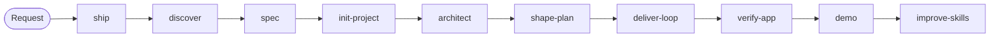

# Skills

David's personal [Claude Code skills](https://docs.claude.com/en/docs/claude-code/skills), kept in git and
installed into `~/.claude/skills` by symlink, so an edit here is live in the next Claude Code session.

A request goes through one controller, `ship`, which calls the phase skills in order and ends with a
demo you can open. Each phase skill also works on its own.



| Skill                                              | Use when                                                                     | Output                                                                            |
| -------------------------------------------------- | ---------------------------------------------------------------------------- | --------------------------------------------------------------------------------- |
| [`ship`](skills/ship/SKILL.md)                     | David hands over a project or feature request and wants it carried to a demo | `docs/delivery/<slug>/status.md` ledger, every phase below                        |
| [`discover`](skills/discover/SKILL.md)             | the request is still an idea                                                 | `brief.md`: PR/FAQ, impact map, hypothesis, appetite                              |
| [`spec`](skills/spec/SKILL.md)                     | "done" must be defined                                                       | `spec.md`: story map, EARS / Given-When-Then criteria, quality targets, non-goals |
| [`init-project`](skills/init-project/SKILL.md)     | the repo does not exist yet                                                  | green, documented repo with conventions, CI and ADR 0001                          |
| [`architect`](skills/architect/SKILL.md)           | the system's shape must be decided                                           | `design.md`, ADRs, fitness functions, threat model, AI-call budgets               |
| [`shape-plan`](skills/shape-plan/SKILL.md)         | the work must be cut into a plan                                             | `plan.md`, walking skeleton first, backlog items, tasks for a fresh subagent      |
| [`deliver-loop`](skills/deliver-loop/SKILL.md)     | backlog items must be built                                                  | per item: story, TDD, QA, independent review ≥ 9/10, commit and push              |
| [`verify-app`](skills/verify-app/SKILL.md)         | before saying anything is done                                               | the app run from the README, evidence per acceptance criterion                    |
| [`demo`](skills/demo/SKILL.md)                     | the result should be shown                                                   | `demo.md` and a page with screenshots, what works, what was cut, how to run       |
| [`improve-skills`](skills/improve-skills/SKILL.md) | a lesson was learned                                                         | the lesson committed into the skill that owns it                                  |

The phase checklists cite the canonical books (Patton, Adzic, Shape Up, Evans, Martin, Ousterhout,
Beck, Fowler, Humble & Farley, Accelerate, Release It!, SRE, Software Engineering at Google, …) and
current agent workflows (Anthropic skill guidance, superpowers, spec-kit, BMad, Kiro, Working
Backwards): see [`skills/ship/references/`](skills/ship/references/).

## Install

```sh
git clone https://github.com/deputychinh/Skills.git ~/Documents/David/Code/skills
cd ~/Documents/David/Code/skills
make install   # npm tooling + links every skill into ~/.claude/skills
```

`make link` only (re)creates the links. An existing real folder with the same name is moved aside
to `~/.claude/skills-backup/<name>.bak-<timestamp>`, never deleted (outside the skills folder, so Claude
Code does not load it twice).

## Layout

```text
skills/<name>/SKILL.md     frontmatter (name, description) + instructions
skills/<name>/templates/   files a skill copies into a project ({{PLACEHOLDERS}} allowed)
skills/<name>/references/  knowledge the skill reads and cites
scripts/check.mjs          validation run by `make check`, the pre-commit hook and CI
scripts/link.sh            the installer
```

## Evals

[`evals/`](evals/README.md) holds scenarios the suite must handle (a PDF-summary app, a Safari bug, resuming a delivery). Run the affected ones in a fresh session after changing a skill.

## Adding or changing a skill

1. Create `skills/<kebab-name>/SKILL.md`; the frontmatter `name` equals the folder.
2. Add the name to `scope-enum` in `commitlint.config.mjs`.
3. `make link && make lint`, then commit, e.g. `feat(deliver-loop): …`.

Lessons learned while using a skill go into that skill (its checklist or gotchas) in the same commit
as the change that taught them. [Kiln](https://github.com/deputychinh/Kiln) is the project these
skills are proven on.
