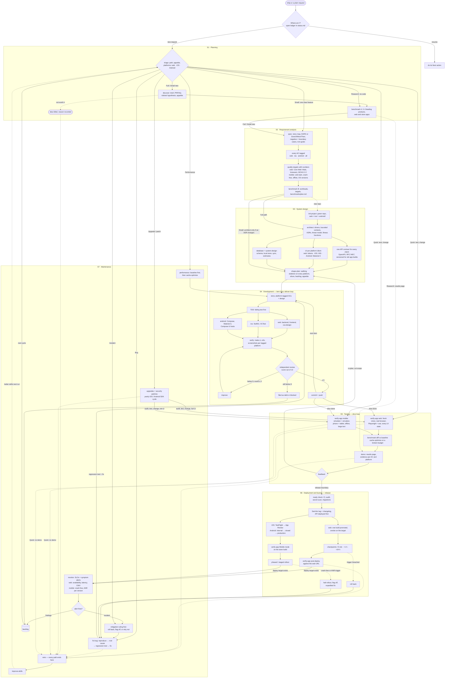

# Software lifecycle skills for Claude Code

A set of [Claude Code skills](https://code.claude.com/docs/en/skills) that carry a request through
the whole software lifecycle: from a vague idea or a bug report to a spec, a design, a plan, reviewed
code, a verified demo, a release with post-deploy checks, monitoring, and maintenance. One skill,
`ship`, is the entry point; it triages the request, keeps a ledger in `docs/delivery/<slug>/status.md`,
decides everything that does not need you, and calls the other 21 skills as specialists. Vue and
React, Node and Python are supported as equals; mobile apps are native, with one native codebase per
store (Swift/SwiftUI for iOS, Kotlin/Jetpack Compose for Android) sharing the same backend API, and your preferences live in a small delivery profile
instead of being baked into the skills.

## One command, the whole lifecycle

Start with `/ship`, or simply ask for what you want; the `ship` description is written so a plain
request triggers it:

```text
/ship a notes app where I can tag notes and search them
/ship the export button does nothing on Safari
error rate went up after this morning's deploy
upgrade our dependencies and patch the security advisories
```

Installed as a plugin, the command is namespaced: `/software-lifecycle:ship` (plain requests work
the same). A long run continues where it stopped: ask `ship` to resume, and it reads the ledger.

## The lifecycle

`ship` follows the seven stages of the software development life cycle — **S1 Planning → S2 Requirement
analysis → S3 System design → S4 Development → S5 Testing → S6 Deployment → S7 Maintenance → back to S1** —
for a web app, native iOS and Android apps, or all three on one shared backend API. Every stage has a
gate, and a gate passes only when it holds on every platform in scope.



| SDLC stage               | `ship` runs                                                            | Web                                                        | iOS and Android                                                                                         | Gate to leave                                             |
| ------------------------ | ---------------------------------------------------------------------- | ---------------------------------------------------------- | ------------------------------------------------------------------------------------------------------- | --------------------------------------------------------- |
| S1 Planning              | triage, `discover`, `benchmark` A                                      | where it is opened, public or logged in, SEO               | why native beats the mobile web, which stores, developer accounts                                       | credible brief; platforms and appetite in the ledger      |
| S2 Requirement analysis  | `spec`, `benchmark` B                                                  | browsers, Core Web Vitals, WCAG 2.2 AA, breakpoints        | minimum OS, phone and tablet, cold start, crash-free and ANR targets, offline, permissions, store rules | every AC tagged by platform; every target has a number    |
| S3 System design         | `init-project`, `architect`, `system-design`, `database`, `shape-plan` | rendering mode, routing, caching, design tokens            | local store and sync, API versioning for old builds, Keychain or Keystore, push, HIG or Material 3      | decisions with fitness checks; skeleton on every platform |
| S4 Development           | `deliver-loop` with `backend`, `frontend`, `css-design`                | Vue or React, four states per view                         | `ios` (SwiftUI, XCTest), `android` (Compose, Compose UI tests)                                          | each item reviewed ≥ 9/10 with its tests                  |
| S5 Testing               | `verify-app`, `benchmark`, `cache-optimize`, `demo`                    | fresh clone, real browser, Playwright + axe                | simulators and emulators, large text, offline, a real mid-range device for timing                       | evidence per AC on every platform; no regression          |
| S6 Deployment and launch | `release`, post-deploy `verify-app`                                    | one build promoted, smoke, +5 min / +1 h / +24 h, rollback | TestFlight and App Review, Play tracks, phased or staged rollout; halt, never roll back a binary        | smoke green on the target; findings in the backlog        |
| S7 Maintenance           | `monitor`, `fix-bug`, upgrades, debt, retro, `improve-skills`          | availability, latency, real-user Core Web Vitals           | crash-free sessions and ANR per version, forced-update policy, yearly OS and SDK upgrades               | alerts with runbooks; findings in the backlog; retro      |

Three loops run inside the cycle: the **item loop** (build → independent review → improve, at most
three rounds, ship at ≥ 9/10), the **slice loop** (items → verify → demo → feedback → re-plan) and the
**learn loop** (every path ends with a retro; `improve-skills` folds the lesson into the skill that
owns that stage). Bugs, incidents and quick fixes join the cycle at the item loop. The full per-stage
detail is in [`skills/ship/references/sdlc-web-mobile.md`](skills/ship/references/sdlc-web-mobile.md).

## What ship calls at each stage

| Skill                                              | SDLC stage      | What it does                                                                                     | When ship calls it                                              |
| -------------------------------------------------- | --------------- | ------------------------------------------------------------------------------------------------ | --------------------------------------------------------------- |
| [`ship`](skills/ship/SKILL.md)                     | entry point     | triage, ledger, decisions, calls everything below                                                | always: any request to build, change, fix or run software       |
| [`discover`](skills/discover/SKILL.md)             | S1 Planning     | one-page brief: PR/FAQ, five customer questions, impact map, riskiest hypothesis, appetite       | the request is still an idea                                    |
| [`spec`](skills/spec/SKILL.md)                     | S2 Requirements | story map, EARS or Given/When/Then criteria, measurable quality targets, non-goals               | "done" must be defined                                          |
| [`benchmark`](skills/benchmark/SKILL.md)           | S1, S2, S5      | product benchmark of leading products; performance plan, baseline, `make bench`, CI guard        | comparing products, or setting and guarding performance targets |
| [`init-project`](skills/init-project/SKILL.md)     | S3 Design       | green, documented repo: conventions, CI, Makefile, ADR 0001, project CLAUDE.md                   | the repo does not exist yet                                     |
| [`system-design`](skills/system-design/SKILL.md)   | S3 Design       | requirements with numbers, estimates, storage and consistency choices, trade-offs, C4 sketch     | a new system or a big part needs its shape decided              |
| [`architect`](skills/architect/SKILL.md)           | S3 Design       | quality characteristics, bounded contexts, ADRs, fitness functions, threat model                 | a spec is ready, or a change touches an ADR                     |
| [`shape-plan`](skills/shape-plan/SKILL.md)         | S3 Design       | ordered plan with an appetite, walking skeleton first, backlog items, circuit breaker            | the work must be cut and planned                                |
| [`deliver-loop`](skills/deliver-loop/SKILL.md)     | S4 Development  | builds backlog items one by one, each through an independent review scored ≥ 9/10                | a backlog exists                                                |
| [`backend`](skills/backend/SKILL.md)               | S4 Development  | layered Node or Python server code, RFC 9457 errors, idempotency, timeouts, tests on a real DB   | an endpoint, job or integration changes                         |
| [`frontend`](skills/frontend/SKILL.md)             | S4 Development  | Vue or React UI with four states per view, accessible forms, role-based tests, Playwright + axe  | a screen, component or data fetch changes                       |
| [`css-design`](skills/css-design/SKILL.md)         | S4 Development  | web UI: tokens, intrinsic layouts, contrast, component states, BEM, screenshot review            | how something looks or lays out on the web changes              |
| [`ios`](skills/ios/SKILL.md)                       | S4 Development  | native iPhone and iPad app in Swift/SwiftUI, Human Interface Guidelines, XCTest, App Store build | the product has an iOS app                                      |
| [`android`](skills/android/SKILL.md)               | S4 Development  | native Android app in Kotlin/Jetpack Compose, Material 3, tests, Play build                      | the product has an Android app                                  |
| [`database`](skills/database/SKILL.md)             | S3, S4, S7      | constraints in the database, zero-downtime migrations, EXPLAIN evidence, tested restore          | a table, index, query or transaction changes                    |
| [`cache-optimize`](skills/cache-optimize/SKILL.md) | S5, S7          | a budget, profiling to the bottleneck, the smallest fix, HTTP and app caching, regression guards | something is slow or a budget applies                           |
| [`verify-app`](skills/verify-app/SKILL.md)         | S5 Testing, S6  | runs the app as the user will and collects evidence per acceptance criterion                     | before anything is called done, and after a deploy              |
| [`demo`](skills/demo/SKILL.md)                     | S5 Testing      | results page: what to open, evidence, what was cut, how to run                                   | a slice, release or milestone is done                           |
| [`release`](skills/release/SKILL.md)               | S6 Deployment   | ready check, SemVer tag and changelog, deploy, checkpoints at +5 min / +1 h / +24 h, rollback    | a release boundary is reached                                   |
| [`monitor`](skills/monitor/SKILL.md)               | S7 Maintenance  | SLOs, symptom alerts, dashboards, runbooks, incident handling                                    | there is a deploy target, or an alert fires                     |
| [`fix-bug`](skills/fix-bug/SKILL.md)               | S7 Maintenance  | reproduce → root cause → failing regression test → fix → verify                                  | a defect, in development or in production                       |
| [`improve-skills`](skills/improve-skills/SKILL.md) | S7 (learn)      | classifies a lesson and commits it into the skill that owns that stage                           | at every retro, or when a skill proved wrong                    |

Each specialist also works on its own when you invoke it directly.

## Install

### As a Claude Code plugin (recommended)

The repository is a plugin marketplace (`.claude-plugin/marketplace.json`) that lists one plugin,
`software-lifecycle`, whose skills are the `skills/` folder. Inside Claude Code:

```text
/plugin marketplace add deputychinh/Skills
/plugin install software-lifecycle@software-lifecycle
```

Or from your shell:

```sh
claude plugin marketplace add deputychinh/Skills
claude plugin install software-lifecycle@software-lifecycle
```

Plugin skills are namespaced, so the entry point is `/software-lifecycle:ship`.

### Manual install by symlink

For working on the skills themselves, link them into `~/.claude/skills` so an edit is live in the
next session (the commands are then un-namespaced, for example `/ship`):

```sh
git clone https://github.com/deputychinh/Skills.git skills
cd skills
make install   # npm tooling + links every skill into ~/.claude/skills
make link      # (re)create the links only
```

An existing real folder with the same name is moved aside to
`~/.claude/skills-backup/<name>.bak-<timestamp>`, never deleted. Use one install method at a time, or
every skill loads twice.

## Delivery profile

Preferences are never baked into the skills. Skills read a `## Delivery profile` section from the
project's `CLAUDE.md`, else from your `~/.claude/CLAUDE.md`. Every key is optional:

| Key              | Default when absent                                                                                                            |
| ---------------- | ------------------------------------------------------------------------------------------------------------------------------ |
| reply language   | the language the user writes in                                                                                                |
| mobile           | the repo's existing apps; new product: ask once at triage (web only, iOS, Android, or several; `monorepo` or `separate repos`) |
| frontend default | the repo's existing framework; new project: ask once at triage (Vue or React both supported)                                   |
| backend default  | the repo's existing stack; new project: ask once at triage (Node/TypeScript or Python both supported)                          |
| autonomy         | decide-and-record: ask only what nobody else can answer (secrets, money, legal, irreversible or outward-facing actions)        |
| push policy      | commit locally; push only when the profile says `push every green commit` and a remote exists                                  |
| review gate      | independent review, ship at ≥ 9/10 with requirements fit = 1 and security ≥ 0.5, at most 3 improve rounds                      |
| deploy target    | none ("local only") until the user names one                                                                                   |
| projects folder  | the current working directory's parent, or ask once                                                                            |

Copy, paste and edit:

```markdown
## Delivery profile

- reply language: English
- frontend default: Vue
- backend default: Python
- mobile: iOS + Android, monorepo
- autonomy: decide-and-record
- push policy: push every green commit
- review gate: ship at ≥ 9/10, requirements fit = 1, security ≥ 0.5, at most 3 improve rounds
- deploy target: none
- projects folder: ~/code
```

## Evals

[`evals/`](evals/README.md) holds scenarios the suite must handle, each with a request, a starting
folder and a checklist. To run one, give a **fresh** Claude Code session (no history, the skills
installed) the scenario's request in the named folder, then grade the transcript and the resulting
repo against the checklist and record the result in `evals/README.md`. Re-run the scenarios that name
a skill after every change to it.

## Contributing

- Layout: `skills/<name>/SKILL.md` (frontmatter `name` = folder name, `description` says what the
  skill produces and when to use it), `templates/` for files a skill copies into a project,
  `references/` for knowledge it reads and cites. Rules for contributors and agents are in
  [`CLAUDE.md`](CLAUDE.md).
- Add a new skill's name to `scope-enum` in `commitlint.config.mjs`.
- `make lint` (Prettier + `scripts/check.mjs`: frontmatter, size, referenced files, placeholders) and
  `claude plugin validate .` must pass.
- Conventional Commits with a scope from `commitlint.config.mjs`, for example
  `feat(fix-bug): reproduce in the browser the user named`.
- A lesson from real use goes into the skill that owns that stage, written as general guidance with
  its reason, in the same commit as the change it caused.

## License

[MIT](LICENSE) — use, change and share the skills freely; keep the copyright notice.
