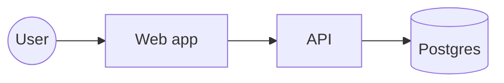

# <Name> — design

Spec: `spec.md` · ADRs: <links> · Updated: <YYYY-MM-DD>

## Driving characteristics

| Characteristic | Target (from spec) | Fitness function | Benchmark row |
| --- | --- | --- | --- |
| | | | [`benchmarks/plan.md`](../../../benchmarks/plan.md) <workload> |

## Context map

| Context | Kind (core/supporting/generic) | Owns | Talks to |
| --- | --- | --- | --- |

## Data

| Flow | Source of truth | Derived | Idempotency | PII / retention |
| --- | --- | --- | --- | --- |

## Integration points

| Dependency | Timeout | Retry | Breaker / bulkhead | Fallback |
| --- | --- | --- | --- | --- |

## AI calls (if any)

| Use | Model | Output schema | Fallback | Eval set / threshold | Cost / latency budget |
| --- | --- | --- | --- | --- | --- |

## Decisions

| ADR | Decision | Rejected options |
| --- | --- | --- |
