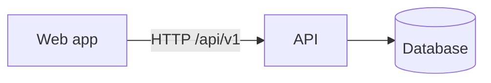

# {{PROJECT_NAME}}

**{{PURPOSE}}**

_One English sentence for readers who do not speak the docs language._

| Screen 1 | Screen 2 |
| --- | --- |
|  |  |

## Quick start

Requires: Python 3.12 + [uv](https://docs.astral.sh/uv/), Node ≥ 24, Docker (for local infrastructure).

```sh
make install   # dependencies
make up        # local infrastructure
make api       # API with reload
make web       # web app
```

`make help` lists every command.

## Features

- …

## Architecture



Details: [docs/architecture/README.md](docs/architecture/README.md) · decisions: [docs/adr](docs/adr) · conventions: [docs/conventions.md](docs/conventions.md) · tests: [docs/testing.md](docs/testing.md).

## Quality

`make ci` = lint + typecheck + test for every part (thresholds in `docs/testing.md`); GitHub Actions runs the same. Commits follow Conventional Commits (scopes in `commitlint.config.mjs`), enforced by husky + commitlint.

## Structure

```
backend/   API (uv, ruff, mypy strict, pytest)
web/       web app (TS strict, ESLint, Stylelint, Vitest, Playwright)
docs/      plan, ADRs, architecture, conventions, testing, screenshots
```

## Licence and data

…
