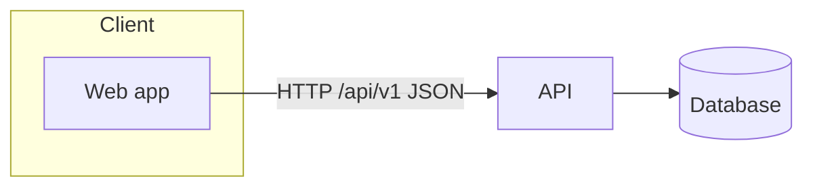

# Architecture

## Boundaries

| Boundary | Contract | Owner |
| --- | --- | --- |
| web → api | OpenAPI (`backend/openapi.json`, generated TS types) | api |

## Cross-cutting

- Config from environment (`{{ENV_PREFIX}}_*`), `.env.example` complete.
- Errors: RFC 9457 problem details with a stable `code`.
- Observability: structured JSON logs with request id; health endpoint `/health`.

Updated with every ADR in `docs/adr/`.
