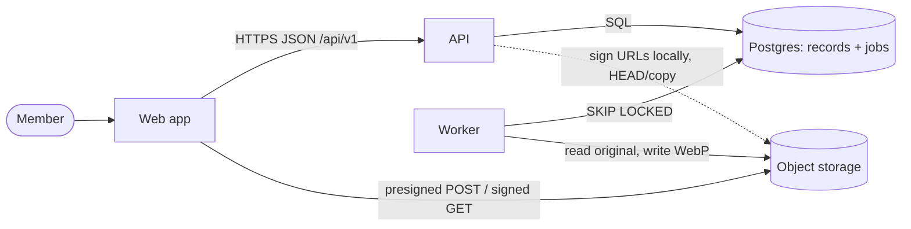

# Worked example: image upload-and-preview pipeline for an "assets" app

Shows the workflow end to end on a neutral sample: a small team app where people upload images and
browse them in a gallery with previews. Every load number is an illustrative assumption
(`HYPOTHESIS`), not a measurement. Prices are from memory — check the provider's pricing page before
using them in a real decision.

## Contents

1. Requirements
2. Estimate
3. Interface and data
4. High-level design
5. Storage
6. Scaling and headroom
7. Reliability and consistency
8. Trade-off tables
9. Hand-off to `architect`

## 1. Requirements

- Use cases: a member uploads an image (new asset or new version); sees it in the gallery with a
  preview; opens the detail page; a retried upload after a network drop never duplicates or loses it.
- Targets: create-asset API p95 < 300 ms; preview ready for 95 % of images within 60 s; no lost or
  duplicated uploads on retry; originals durable (object storage, versioned keys); availability
  99.5 % (`HYPOTHESIS` for an internal team tool); cost < $300/month in year one (`HYPOTHESIS`).
- Constraints: one developer; an API (FastAPI or Node) + Postgres + a background worker + S3-compatible
  storage; no GPU.
- Non-goals: video, 3D models, real-time collaboration, multi-region.

## 2. Estimate

Assumptions (`HYPOTHESIS`): 50 members; 40 uploads each per working day; average file 20 MB; 8 busy
hours; burst factor 5 over the busy-hour average; 250 working days; 100 gallery views per member per
day with 24 thumbnails of 40 KB; 90 % ordinary images at 4 CPU-s each, 10 % very large
images at 30 CPU-s; 7 API calls
per upload (create, completion, status polls).

`estimate.py` output (stdlib script as in `estimation-and-scaling.md` §1):

```text
uploads/day 2,000  avg 0.07/s  peak 0.35/s
API requests/day 19,000  peak 3.3/s
originals 40 GB/day  10 TB/year
upload ingress at peak 56 Mbit/s
thumbnail GETs/day 120,000  egress 4.8 GB/day
worker CPU 3.7 CPU-h/day  busy workers at peak 2.3
Postgres rows ~3 GB/year
```

Reading it:

- API load (3 req/s peak) is trivial for one API process and one Postgres. Not the driver.
- **Limiting numbers:** upload bytes (56 Mbit/s at peak, 20 MB bodies) and **worker CPU at peak
  (≈ 2–3 busy workers, with 30 s renders of the largest images)**. Storage growth (10 TB/year) drives cost.
- Postgres stays small (~3 GB/year): no partitioning, no replica.

## 3. Interface and data

| Endpoint                                       | Purpose                                         |
| ---------------------------------------------- | ----------------------------------------------- |
| `POST /api/v1/assets` (`Idempotency-Key`)      | create asset + version 1, return presigned POST |
| `POST /api/v1/assets/{id}/versions`            | next version + presigned POST                   |
| `POST /api/v1/asset-versions/{id}/completions` | verify upload, promote, enqueue thumbnail       |
| `GET /api/v1/assets?limit=&cursor=`            | gallery page with signed preview URLs           |

Entities: `Asset` (~0.5 KB), `AssetVersion` (state `pending_upload → processing → ready|failed`,
~0.5 KB), `Job` (~1 KB), `IdempotencyKey` (~1 KB, purged after 24 h). Access patterns: gallery
newest-first by `(created_at, id)` keyset; versions by asset; claimable jobs by `(state, run_after)`;
expired pending versions by `(state, created_at)`.

## 4. High-level design



Upload flow: create (asset + version + key row in one transaction) → client POSTs the file straight
to a staging key → completion `HEAD`s, checks size/type, copies to the final key with
`CopySourceIfMatch`, sets `processing` and inserts the `thumbnail` job **in one transaction** →
worker claims with a lease, decodes and resizes in a sandboxed child process, writes `thumbs/…webp`, marks `ready`.

## 5. Storage

| Data                   | Consistency need                                          | Store                  | Why not Postgres             |
| ---------------------- | --------------------------------------------------------- | ---------------------- | ---------------------------- |
| Assets, versions, keys | linearizable on the primary; one transaction per use case | Postgres               | —                            |
| Job queue / outbox     | at-least-once, claimed once per lease                     | Postgres `SKIP LOCKED` | — (0.35 jobs/s peak)         |
| Originals (10 TB/yr)   | durable, immutable per version                            | object storage         | blobs of 20 MB; cheap per GB |
| Thumbnails             | eventual (derived; rebuildable from originals)            | object storage         | same                         |

## 6. Scaling and headroom

| Bottleneck         | Rung                                                                               | Headroom at year-one peak                                                   |
| ------------------ | ---------------------------------------------------------------------------------- | --------------------------------------------------------------------------- |
| Upload bytes       | presigned POST, bytes never touch the API                                          | API carries only JSON; storage scales independently                         |
| Worker CPU         | rung 4 (queue) + N worker processes                                                | 4 worker slots (assumed) vs 2.3 busy → ~1.7×; **raise to 8 slots for ≥ 3×** |
| Gallery thumbnails | rung 5: signed URLs stable per 10-min window + `Cache-Control: private, immutable` | browser cache absorbs repeats                                               |
| API / Postgres     | rung 0–1 only                                                                      | > 100×                                                                      |

At 10× (500 members): worker slots ×10 (separate machines, same queue), storage ~100 TB/year so
lifecycle rules matter, still one Postgres. A broker becomes worth discussing only past hundreds of
jobs/s.

## 7. Reliability and consistency

- Client retries: `Idempotency-Key` on create; completion idempotent by version state.
- Storage outage: circuit breaker + bulkhead around storage calls, 503 with `Retry-After`; signing
  is local so the gallery keeps working.
- Worker crash or hang: lease expiry → re-claim; watchdog ends a hung process; handler checks the
  ETag recorded at completion so a replaced object is never thumbnailed by mistake.
- Abandoned uploads: hourly maintenance expires `pending_upload` after 24 h and deletes staging objects.
- Consistency: the version row is the source of truth; thumbnail is eventual and the UI shows
  "processing" until `ready`. SLO: 95 % of images ready within 60 s (freshness SLI from job timestamps).

## 8. Trade-off tables

### Decision: how do file bytes reach storage?

| Option                         | Upload throughput        | API load                  | Integrity control                                     | Ops burden | Reversibility |
| ------------------------------ | ------------------------ | ------------------------- | ----------------------------------------------------- | ---------- | ------------- |
| Stream through the API         | bounded by API processes | 56 Mbit/s through the API | full                                                  | medium     | easy          |
| Presigned PUT                  | storage-native           | JSON only                 | weak: size/type not enforced by all servers           | low        | easy          |
| **Presigned POST with policy** | storage-native           | JSON only                 | key, type and exact size pinned; re-checked by `HEAD` | low        | easy          |

Choice: presigned POST — it removes the limiting number from the API and keeps size/type
enforcement. Revisit when: a target store rejects POST policies.

### Decision: job queue

| Option                             | Fits 0.35 jobs/s      | Transactional enqueue                   | New infrastructure | Ops burden (solo) |
| ---------------------------------- | --------------------- | --------------------------------------- | ------------------ | ----------------- |
| **Postgres table + `SKIP LOCKED`** | yes, far below limits | yes, same transaction (outbox for free) | none               | low               |
| Redis + RQ/Celery                  | yes                   | no — needs an outbox anyway             | Redis              | medium            |
| Managed queue (SQS)                | yes                   | no — outbox + relay                     | cloud account      | medium            |

Choice: Postgres queue. Revisit when: sustained jobs > ~500/s or several independent consumers.

### Decision: object storage provider (prices from memory, verify)

| Option                       | Storage ≈ $/GB-month | Egress | Year-one bill at 10 TB       | Lock-in              |
| ---------------------------- | -------------------- | ------ | ---------------------------- | -------------------- |
| AWS S3 Standard              | ~0.023               | paid   | ~$230/month storage + egress | low (S3 API)         |
| Cloudflare R2                | ~0.015               | free   | ~$150/month                  | low (S3 API)         |
| Self-hosted Garage/SeaweedFS | disks + ops          | free   | hardware + time              | lowest, highest toil |

Choice: S3 API behind an `ObjectStorage` port, an S3-compatible server locally, provider chosen at
deploy. Revisit when: the storage bill passes $300/month or egress dominates.

## 9. Hand-off to `architect`

ADRs: presigned POST uploads; staging keys + conditional promotion; idempotency keys in one
transaction; Postgres job queue with leases; sandboxed image decoding; signed-URL windows.
Fitness functions to define there: create p95 < 300 ms in an API timing test; thumbnail freshness
from job timestamps; a test asserting the lease arithmetic; the domain import rule.
